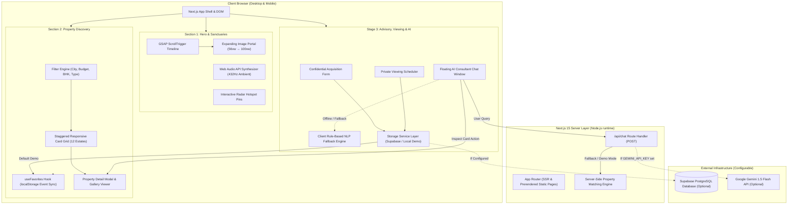
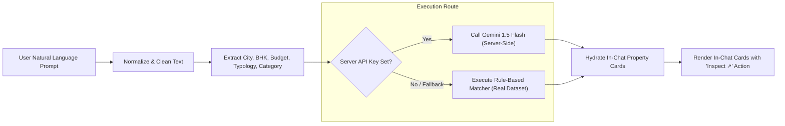

# AVENORA — System Architecture & Technical Specifications

**Platform**: AVENORA Luxury Real Estate Discovery  
**Architecture Standard**: Next.js 15 App Router, React 19, TypeScript 5, GSAP ScrollTrigger, Hybrid Client/Server AI  
**Document Version**: 1.0.0 (Hackathon Release)  

---

## 1. System Architecture Diagram



---

## 2. Technology Stack & Runtime Environment

| Layer | Technology | Version | Purpose |
| :--- | :--- | :--- | :--- |
| **Framework** | Next.js | `15.5.29` | App Router, SSR, Static Prerendering, API Routes |
| **Core Library** | React & React DOM | `19.1.0` | Component lifecycle, hooks, concurrent rendering |
| **Language** | TypeScript | `^5.0.0` | Strict static typing across domain models and contracts |
| **Styling** | Tailwind CSS | `^4.0.0` | Theme tokens, utility classes, and layout engine |
| **Animation** | GSAP & ScrollTrigger | `^3.12.7` | Pinned timeline scrubbing, parallax counter-zoom, card stagger |
| **Audio** | Web Audio API | Native Browser | Pure client-side harmonic ambient drone synthesizer |
| **Icons** | Lucide React | `^0.475.0` | Modern, lightweight architectural line icons |
| **Persistence** | Supabase REST / LocalStorage | Hybrid | Dual-mode persistence with honest client demo disclosures |
| **AI Integration** | Google Gemini 1.5 Flash / Rule-Based NLP | Dual-Layer | Natural language real estate entity extraction and matching |
| **QA Automation**| Puppeteer Core & Chrome | `^24.0.0` | Headless visual and functional verification suite |

---

## 3. Directory & Component Architecture

```
AVENORA/
├── docs/
│   ├── PRD.md                  # Product Requirements Document
│   ├── DESIGN_DOCUMENT.md      # Design System, Palette & User Journeys
│   └── ARCHITECTURE.md         # System Topology, Database & API Contracts
├── public/                     # Static media assets & icons
├── scripts/
│   ├── verify-ui.mjs           # Section 1 visual verification script
│   ├── verify-section2.mjs     # Section 2 filter & gallery test script
│   └── verify-stage3.mjs       # Stage 3 forms & AI chat test script
├── src/
│   ├── app/
│   │   ├── api/
│   │   │   └── chat/
│   │   │       └── route.ts    # Server-side AI consultant API endpoint
│   │   ├── globals.css         # Tailwind v4 theme, palette & scrollbar styling
│   │   ├── layout.tsx          # Root layout with Cormorant & Plus Jakarta fonts
│   │   └── page.tsx            # Main application page (Sections 1, 2, 3)
│   ├── components/
│   │   ├── ai/
│   │   │   └── AIConsultantChat.tsx        # Floating AI chat window & card triggers
│   │   ├── contact/
│   │   │   ├── ContactSection.tsx          # Confidential inquiry form & desk directory
│   │   │   └── ViewingRequestForm.tsx      # Private viewing booking scheduler
│   │   ├── discovery/
│   │   │   ├── PropertyCard.tsx            # Residence card with hover zoom & favorite
│   │   │   ├── PropertyDetailModal.tsx     # Full modal with gallery, specs & inquiry
│   │   │   ├── PropertyDiscoverySection.tsx# Section 2 container with GSAP stagger
│   │   │   └── PropertyFilters.tsx         # Combined multi-parametric filter engine
│   │   ├── hero/
│   │   │   └── HeroScrollSection.tsx       # Section 1 pinned expanding image hero
│   │   ├── navigation/
│   │   │   └── Navbar.tsx                  # Fixed editorial navigation with mobile drawer
│   │   └── ui/
│   │       ├── BrandLogo.tsx               # Monogram logo emblem & wordmark
│   │       ├── HotspotPin.tsx              # Interactive architectural radar pin
│   │       ├── LuxuryButton.tsx            # Reusable button with 4 luxury variants
│   │       └── SoundAmbienceToggle.tsx     # Web Audio API ambient pad generator
│   ├── data/
│   │   ├── properties.ts       # 12 curated Indian luxury demo listings
│   │   └── sanctuaries.ts      # 3 global architectural hero scenes
│   ├── hooks/
│   │   └── useFavorites.ts     # LocalStorage favorites persistence & sync
│   ├── services/
│   │   ├── aiMatcher.ts        # Rule-based natural language real estate NLP matcher
│   │   └── storage.ts          # Dual-layer storage service (Supabase / Local Demo)
│   └── types/
│       └── index.ts            # TypeScript interfaces & domain types
├── next.config.ts              # Next.js configuration (remotePatterns for Unsplash)
├── package.json                # Dependencies and build scripts
├── tsconfig.json               # TypeScript compiler configuration
└── .env.example                # Clean template for environment variables
```

---

## 4. Database Schema Specifications

The platform supports a dual-layer persistence model. When Supabase environment variables are provided, it interacts with PostgreSQL tables. When not configured, it persists to structured `localStorage` JSON arrays.

### 4.1 Table: `inquiries` (Contact Advisory Briefs)

```sql
CREATE TABLE inquiries (
    id VARCHAR(64) PRIMARY KEY, -- e.g. 'AVN-INQ-X1BW-3640'
    name VARCHAR(255) NOT NULL,
    email VARCHAR(255) NOT NULL,
    phone VARCHAR(64) NOT NULL,
    location VARCHAR(128) NOT NULL,
    property_type VARCHAR(128) NOT NULL,
    budget VARCHAR(128) NOT NULL,
    message TEXT NOT NULL,
    created_at TIMESTAMPTZ DEFAULT NOW(),
    source VARCHAR(32) DEFAULT 'web_client'
);
```

### 4.2 Table: `viewing_requests` (Private Viewing Appointments)

```sql
CREATE TABLE viewing_requests (
    id VARCHAR(64) PRIMARY KEY, -- e.g. 'AVN-VIEW-X2HY-2473'
    property_id VARCHAR(128) NOT NULL,
    property_title VARCHAR(255) NOT NULL,
    property_city VARCHAR(128) NOT NULL,
    preferred_date DATE NOT NULL,
    time_slot VARCHAR(128) NOT NULL,
    name VARCHAR(255) NOT NULL,
    phone VARCHAR(64) NOT NULL,
    email VARCHAR(255) NOT NULL,
    notes TEXT,
    created_at TIMESTAMPTZ DEFAULT NOW(),
    status VARCHAR(32) DEFAULT 'pending_verification'
);
```

### 4.3 Table: `properties` (Domain Entity Model)

```typescript
export interface PropertyListing {
  id: string;                    // e.g. "avn-mum-aurelia"
  code: string;                  // e.g. "AVN-MUM-01"
  title: string;                 // "The Aurelia Sky Penthouse"
  tagline: string;               // "Arabian Sea Horizon & Private Heli-Lounge"
  city: PropertyCity;            // "Mumbai" | "Pune" | "Bangalore" | "Hyderabad"
  locality: string;              // "Worli Sea Face"
  price: number;                 // Numeric INR for filtering (e.g. 385000000)
  priceFormatted: string;        // "₹38.50 Cr" or "₹6.50 L / mo"
  category: ListingCategory;     // "buy" | "rent"
  propertyType: PropertyType;    // "Penthouse" | "Architectural Villa" | etc.
  bedrooms: number;              // 3, 4, 5, 6
  bathrooms: number;             // 4, 5, 6, 8
  areaSqFt: number;              // 7200
  areaFormatted: string;         // "7,200 sq.ft"
  images: string[];              // Curated array of 3-4 photo URLs
  description: string;           // Architectural monograph narrative
  amenities: string[];           // Array of 6-8 amenity tags
  specifications: {
    flooring: string;
    ceilingHeight: string;
    facing: string;
    parking: string;
    furnishing: string;
    possession: string;
    reraId: string;
  };
  isFeatured?: boolean;
  isDemo: boolean;               // Always true for demonstration safety
}
```

---

## 5. API Contracts & Endpoint Specifications

### Endpoint: `POST /api/chat`

Handles conversational natural language queries from the floating AI Property Consultant.

#### Request Headers
```http
Content-Type: application/json
```

#### Request Body
```json
{
  "message": "2BHK in Pune"
}
```

#### Response Schema (HTTP 200 OK)
```json
{
  "content": "AVENORA's curated collection in Pune focuses on ultra-luxury estates starting from 3 BHK...",
  "matchedProperties": [
    {
      "id": "avn-pne-forest",
      "code": "AVN-PNE-03",
      "title": "The Lane 6 Canopy Residence",
      "city": "Pune",
      "locality": "Lane 6, Koregaon Park",
      "priceFormatted": "₹3.20 L / mo",
      "bedrooms": 3,
      "images": ["https://images.unsplash.com/..."]
    }
  ],
  "suggestedQueries": [
    "rental properties in Pune",
    "luxury villa in Pune",
    "penthouses in Mumbai"
  ],
  "mode": "demo_rule_based" // or "ai_live" if GEMINI_API_KEY configured
}
```

#### Error Response (HTTP 400 Bad Request)
```json
{
  "error": "Message content cannot be blank"
}
```

---

## 6. AI Architecture & Query Matching Pipeline



### Entity Extraction Rules:
- **Location**: Extracts Mumbai, Pune, Bangalore/Bengaluru, Hyderabad, Worli, Pali Hill, Koregaon Park, Lavelle Road, Jubilee Hills.
- **Bedrooms**: Matches patterns `2bhk`, `3 bhk`, `4 bedrooms`, `5+ suites`.
- **Typology**: Matches `villa`, `penthouse`, `duplex`, `heritage`, `sky residence`.
- **Category**: Matches `rent`, `lease`, `buy`, `sale`, `purchase`.
- **Budget Thresholds**: Distinguishes capital acquisition budgets (`crore`, `cr`, `above 15 cr`) from monthly lease budgets (`lakh`, `lakh/mo`, `under 80 lakh`).

---

## 7. Security, Privacy & Error Handling

1. **Server-Side Secret Isolation**: `GEMINI_API_KEY` and Supabase service role keys are strictly referenced in server route handlers (`/api/chat/route.ts` and server utilities). No secrets are exposed to client bundle outputs.
2. **Honest Persistence Reporting**: When external services are unconfigured, forms write to `localStorage` and display clear disclosures stating: *"Demo Environment Notice: Logged in Local Demo Storage... No outbound message was dispatched to an external agent."*
3. **Cross-Site Scripting (XSS) Prevention**: All user inputs in chat and forms are bound via React synthetic attributes and sanitized through controlled state handlers.
4. **Resilient Network Fallback**: If the server-side AI API fails, times out, or reaches rate limits, the client transparently switches to the local rule-based matching engine without UI disruption.
